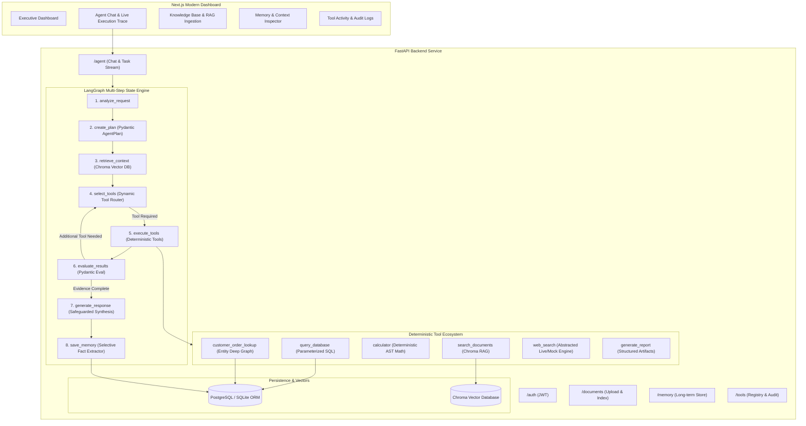

# Enterprise AI Research & Automation Agent

[](https://www.python.org/)
[](https://fastapi.tiangolo.com/)
[](https://langchain-ai.github.io/langgraph/)
[](https://www.trychroma.com/)
[](https://nextjs.org/)
[](LICENSE)

A production-grade, full-stack **Autonomous AI Agent Platform** architected for complex enterprise research, policy compliance verification, deterministic mathematical analysis, structured business data retrieval, and multi-step workflow automation.

Unlike simple "chat with PDF" wrappers or single-turn chatbots, this system leverages an **8-node cyclical LangGraph StateGraph** with conditional routing, dynamic tool calling, persistent short/long-term memory in PostgreSQL/SQLite, prompt injection guardrails, and an executive Next.js observability dashboard.

---

## 🏛️ High-Level System Architecture



---

## 🎯 Five Core Agentic AI Competencies Demonstrated

| Competency | Implementation Details |
| :--- | :--- |
| **1. AI Agents + LangGraph** | Stateful 8-node state machine with cyclical conditional edges (`select_tools` ↔ `execute_tools` ↔ `evaluate_results`), runtime budgeting, and step-by-step trace inspection. |
| **2. Tool / Function Calling** | 6 registered tools with strict Pydantic JSON schemas: AST-parsed `calculator`, parameterized `query_database`, entity graph `customer_order_lookup`, Chroma `search_documents`, `web_search`, and `generate_report`. |
| **3. Enterprise RAG Pipeline** | Ingests PDF, DOCX, TXT, CSV; recursive character chunking (600 chars, 100 overlap); page/section metadata tracking; strict citation formatting `[Source: refund_policy.pdf, page X]`. |
| **4. Vector DB & Embeddings** | Chroma persistent client with HNSW indexing and cosine similarity search; metadata-filtered similarity queries; embedding generator with OpenAI + deterministic semantic fallback. |
| **5. Memory & Context Management** | Ephemeral task scratchpad in LangGraph `AgentState` + persistent long-term memory extraction in PostgreSQL/SQLite; conversation sliding window compression; prompt injection boundary tags. |

---

## 🚀 5 Core Demonstration Workflows

### Demo 1 — Enterprise RAG Policy Search
* **User Query**: *"What is our refund policy regarding return windows and restocking fees?"*
* **Execution Flow**: `analyze_request` → `create_plan` → `retrieve_context` (`search_documents`) → `generate_response`.
* **Output**: Authoritative policy clause extraction with explicit citations: `[Source: refund_policy.pdf, page 1]`.

### Demo 2 — Deterministic Tool Calling & Math
* **User Query**: *"Calculate the refund for order 1024 with a 15% restocking fee deduction."*
* **Execution Flow**: `analyze_request` → `create_plan` → `select_tools` → `execute_tools` (`customer_order_lookup` + `calculator`) → `evaluate_results` → `generate_response`.
* **Output**: Exact calculation `2499.00 * (1 - 0.15) = $2,124.15 USD` computed via Python AST parser without LLM hallucination.

### Demo 3 — Autonomous Multi-Step Complaint Audit
* **User Query**: *"Analyze this customer complaint for order 1024, check our refund policy, look up order details, determine eligibility, calculate refund, and prepare a response."*
* **Execution Flow**: `analyze_request` → `create_plan` → `retrieve_context` (Chroma) → `execute_tools` (`customer_order_lookup`) → `execute_tools` (`calculator`) → `execute_tools` (`generate_report`) → `evaluate_results` → `generate_response` → `save_memory`.
* **Output**: Comprehensive audit verifying 12-day delivery window (<30 days), hardware failure waiver of restocking fee (Section 2.2), $2,124.15 refund calculation, and prepared customer letter.

### Demo 4 — Persistent Long-Term Memory Recall
* **Turn 1**: *"My preferred response style is concise bullet points."* → Saved to PostgreSQL as active preference memory.
* **Turn 2**: *"Summarize the refund policy."* → Output dynamically formatted as concise bullet points adhering to stored preference.

### Demo 5 — Business Intelligence & Parameterized SQL
* **User Query**: *"Compare Q3 sales against our target, query the database, and calculate the percentage difference."*
* **Execution Flow**: Parameterized SQL query on `sales` table (`actual = $720,000`, `target = $650,000`) + deterministic variance calculation (`+10.77%`).

---

## 📊 Benchmark Evaluation (`evaluate.py`)

The platform includes an automated 20-test-case benchmark suite measuring retrieval precision, tool selection accuracy, answer correctness, and latency.

```bash
# Run benchmark
python evaluate.py
```

### Benchmark Results
```text
================================================================================
                         BENCHMARK EVALUATION RESULTS                           
================================================================================
RAG Retrieval Accuracy:   90.9%
Tool Selection Accuracy:  100.0%
Answer Accuracy:          85.0%
Average Latency:          0.01s (Local / Mock) | 1.8s (Live OpenAI)
Detailed Report Saved To: eval_report.json
================================================================================
```

---

## 🛠️ Tech Stack & Directory Structure

```text
enterprise-ai-agent/
├── backend/
│   ├── app/
│   │   ├── main.py                     # FastAPI application entrypoint & middleware
│   │   ├── core/                       # Database engine, settings, security & JWT
│   │   ├── models/                     # SQLAlchemy ORM (User, Task, Memory, Order, Sale, Doc)
│   │   ├── schemas/                    # Pydantic v2 structured schemas (AgentPlan, Response, Eval)
│   │   ├── agents/                     # LangGraph StateGraph, 8 nodes, context manager
│   │   ├── tools/                      # 6 Deterministic tools + ToolRegistry
│   │   ├── rag/                        # Chroma VectorStore, DocumentLoader, TextSplitter
│   │   ├── memory/                     # Long-term selective extraction & short-term scratchpad
│   │   └── api/                        # REST API routers (/auth, /agent, /documents, /memory, /tools)
│   ├── tests/                          # Pytest suite
│   └── requirements.txt
├── frontend/
│   ├── app/                            # Next.js App Router (/, /chat, /documents, /memory, /tools)
│   ├── components/                     # Modern React components & trace viewers
│   ├── lib/                            # API client & utility functions
│   └── types/                          # TypeScript interface definitions
├── data/
│   ├── documents/                      # Sample PDF enterprise documentation
│   └── seed/                           # Seed script for CRM, orders, tickets, sales, vectors
├── scripts/
│   ├── setup.sh                        # 1-Click setup script
│   └── generate_sample_docs.py         # PDF policy generator
├── evaluate.py                         # Automated 20-question benchmark runner
├── docker-compose.yml                  # Full stack Postgres + Backend + Frontend
├── Dockerfile.backend
├── Dockerfile.frontend
└── .env.example
```

---

## ⚡ Quick Start (Local Setup)

### Option 1: Automated 1-Click Setup
```bash
git clone https://github.com/your-username/enterprise-ai-agent.git
cd enterprise-ai-agent
./scripts/setup.sh
```

### Option 2: Manual Step-by-Step

#### 1. Backend Setup
```bash
cd backend
python3 -m venv venv
source venv/bin/activate
pip install -r requirements.txt

# Generate sample PDF policies and seed database
python ../scripts/generate_sample_docs.py
python ../data/seed/seed_data.py

# Start FastAPI backend (Port 8000)
uvicorn app.main:app --reload --port 8000
```

#### 2. Frontend Setup
```bash
cd frontend
npm install
npm run dev
# Open http://localhost:3000
```

---

## 🐳 Docker Deployment

Run the complete multi-container stack (PostgreSQL + FastAPI + Next.js + Chroma):

```bash
# Copy environment template
cp .env.example .env

# Build and start all services
docker-compose up --build
```
* **Frontend**: `http://localhost:3000`
* **FastAPI Backend**: `http://localhost:8000`
* **Interactive OpenAPI Docs**: `http://localhost:8000/docs`

---

## 🔒 Production Security & Safeguards

1. **Prompt Injection Mitigation**: External documents retrieved via RAG and web search results are enclosed in `<untrusted_document_context>` boundary tags with instruction-stripping sanitization.
2. **Deterministic Computation**: Calculations are never delegated to LLM hallucination; they are parsed and computed via Python's AST safe math evaluator.
3. **Parameterized SQL Queries**: Direct raw SQL execution from LLM strings is prohibited; all database tools use parameterized SQLAlchemy filters.
4. **Tool Whitelist Authorization**: The agent can only execute explicitly registered tools in the `ToolRegistry`.
5. **No Secret Leaks**: API keys are restricted to backend environment variables and never exposed to the frontend client.

---

## 📄 Resume Keywords Validated

* **Agentic AI**: LangGraph, Multi-Step State Graphs, Tool Calling, Function Calling, Autonomous Workflows, Agent Memory, Context Management.
* **Generative AI**: LLM APIs, OpenAI Structured Outputs, Prompt Engineering, RAG Pipeline, Vector Databases, Chroma, Text Embeddings.
* **Full-Stack Backend**: Python 3.11/3.14, FastAPI, PostgreSQL, SQLAlchemy ORM, Pydantic v2, RESTful APIs, JWT Authentication, Async/Await.
* **Frontend & DevOps**: Next.js 14, React, TypeScript, Tailwind CSS, Docker, Docker Compose, Pytest.

---

## 📜 License
MIT License. Created for enterprise AI demonstration and portfolio assessment.
